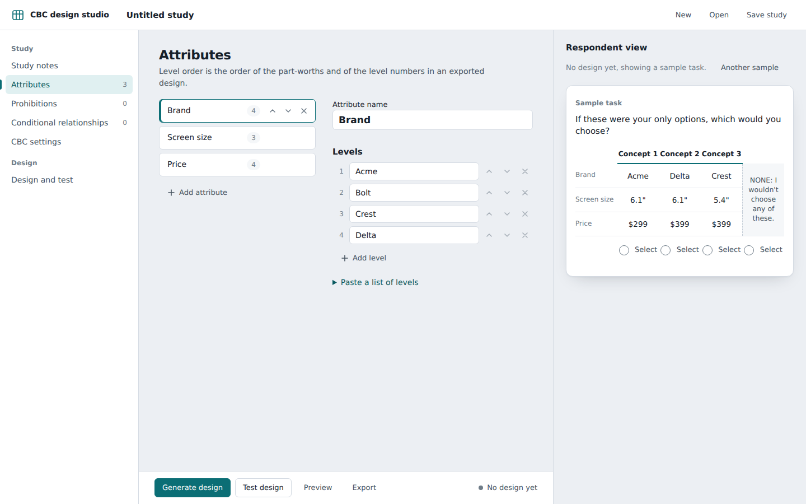
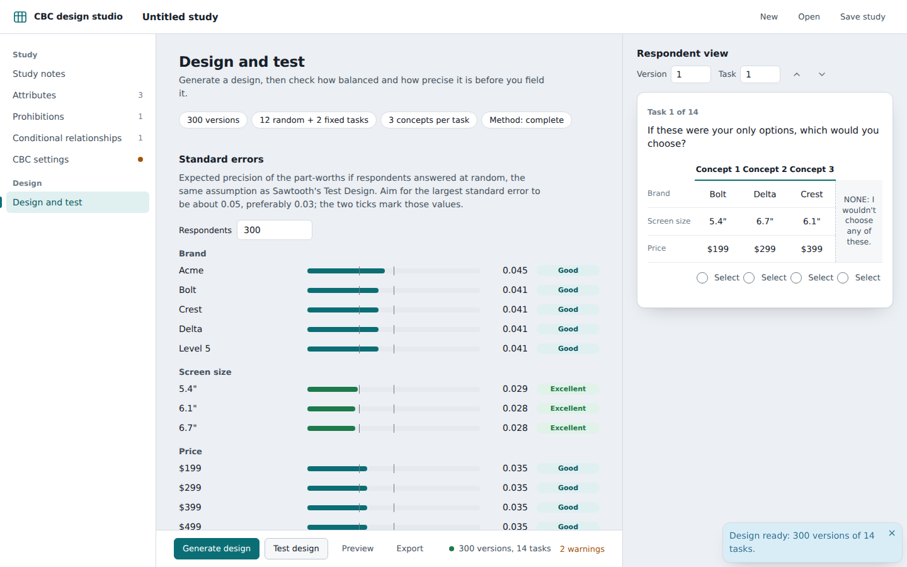

# CBC design studio

A Shiny app for designing choice-based conjoint (CBC) exercises, modelled on the CBC part of
Sawtooth Software's SSI Web / Lighthouse Studio: define attributes and levels, prohibitions and
conditional relationships, set up the tasks, generate the design, test it, and save it as `.csv`
or Sawtooth `.cho`.



## Run

```r
shiny::runApp("inst/shiny/cbc-designer")
```

or, once the package is installed, `shiny::runApp(system.file("shiny/cbc-designer", package = "choicetools"))`.
It needs only the `shiny` package. Fonts (IBM Plex Sans) come from Google Fonts when online and fall back to
system fonts otherwise. The interface is in English, using SSI Web's terms.

## What it covers

| Page | What you do |
| --- | --- |
| Study notes | Notes, a summary of the study, and the list of checks (errors block generating, warnings do not) |
| Attributes | Add, rename, reorder attributes and levels; paste a list of levels |
| Prohibitions | Click cells of a level-by-level grid for any pair of attributes |
| Conditional relationships | Show different text for an attribute depending on other attributes (for example price by brand) |
| CBC settings | General (random and fixed tasks, concepts, columns, discrete choice or constant sum), None option (none, traditional, dual-response), Format, Design, Fixed tasks, Import / export design |
| Design and test | Standard errors, level balance, attribute pair association, overlap, position balance, a browser for the tasks of any version |

The panel on the right is the respondent view: the task as respondents would see it, with the attribute
order of that respondent, conditional text and the None option. Without a design it shows a sample task.
A design goes out of date as soon as anything that shapes it changes (levels, prohibitions, task counts,
fixed tasks, seed). Editing labels, None text or layout does not.

## Design methods

All four never show a prohibited or repeated concept and are reproducible from the seed.

* **Complete enumeration**: per concept, fewest repeated levels in the task first, then the most balanced and
  orthogonal choice among all feasible concepts (a sample of 3,000 when the space is larger).
* **Shortcut**: builds a concept attribute by attribute from the least-used levels.
* **Balanced overlap**: like complete enumeration, but overlap inside a task is allowed.
* **Random**: uniformly random feasible concepts.

These follow the published ideas behind Sawtooth's methods; they are **not** Sawtooth's code, so designs are
comparable in quality but not identical. Level balance outranks pair balance.

## Testing a design

"Test design" reports standard errors for every level and the None constant, assuming respondents answer at
random, the same assumption as Sawtooth's Test Design. It is computed analytically from the MNL information
matrix (and checked against a numerical Hessian in the tests). Ratings use Sawtooth's guideline: the largest
main-effect standard error about 0.05, preferably 0.03. Only random tasks are tested.

## Files

* **Design (.csv)**: `Version, Task, Concept, Att1 ... AttN`, one row per concept, level numbers as in the
  codebook. Rows run respondent (version), then trial (task), then card (concept), the same order as the
  `tab` matrices used elsewhere in choicetools. Headers can be attribute names; a `Fixed` column is optional.
* **Design with labels (.csv)**, **Codebook (.csv)**, **Conditional display (.csv)**: what the level numbers
  and displayed texts mean.
* **Sawtooth .cho**: one respondent per version. Header `id, extras, attributes, tasks, none (0/1/2)`, an
  optional extra variable (the version number), then per task `concepts, 1`, one line of levels per concept
  and an answer line (`0` = missing; None = concepts + 1; dual-response writes four values). Answers can be
  left missing, simulated at random, or simulated from random part-worths (for testing analysis code).
  Comma-delimited by default (as choicetools reads it), space optional. Written from Sawtooth's documentation
  and checked with an independent parser; it has not been loaded into Sawtooth's own software.
* **Study (.json)**: the whole study (not the generated design, which the seed reproduces). **Import design**
  reads a `.csv` back in and refuses files that do not fit the study, saying what to change.

CSV files are UTF-8 without a byte-order mark. To open one with Cyrillic text in Excel, use
Data, From Text/CSV and choose UTF-8.

## Not covered

Alternative-specific and partial-profile designs, interactions between attributes in the design, numeric or
summed price attributes, constant-sum `.chs` files, and a Russian interface.

## Tests

```sh
Rscript inst/shiny/cbc-designer/tests/run-tests.R
```

No test packages needed. The suite covers the study model, all four methods, the report, the exports and
imports, the page builders, and the server (via `shiny::testServer`).


